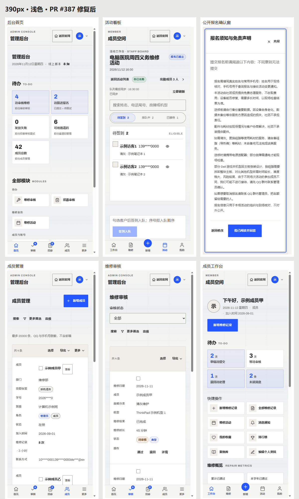
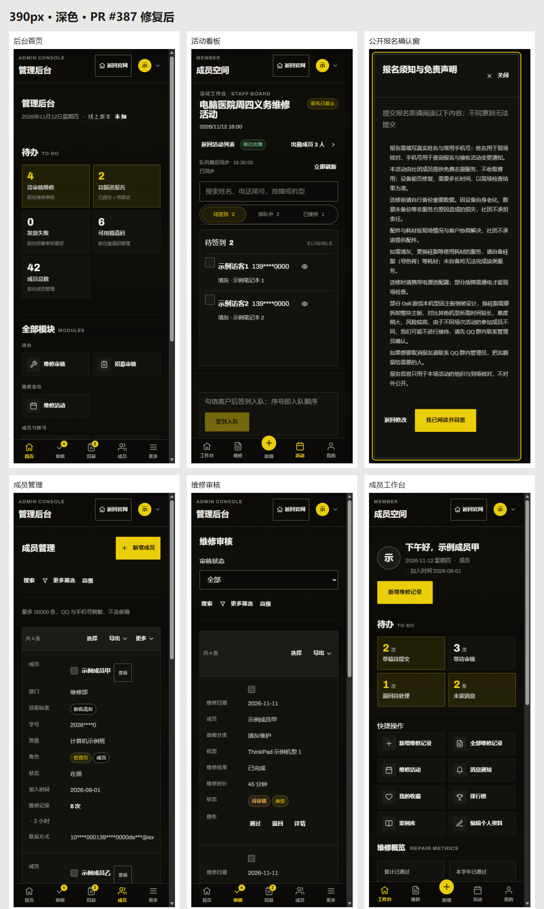
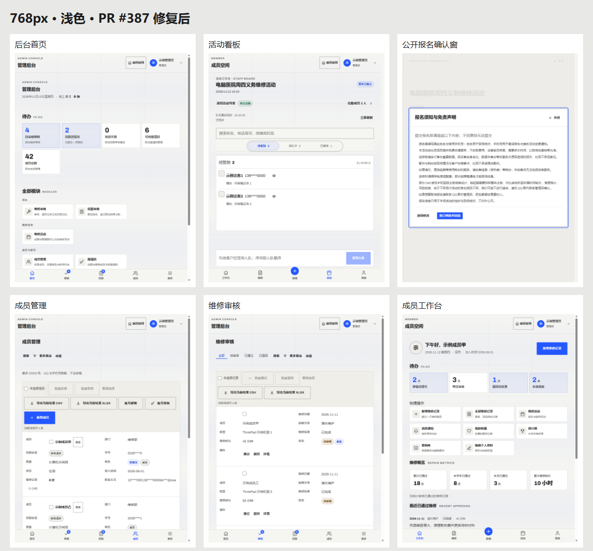
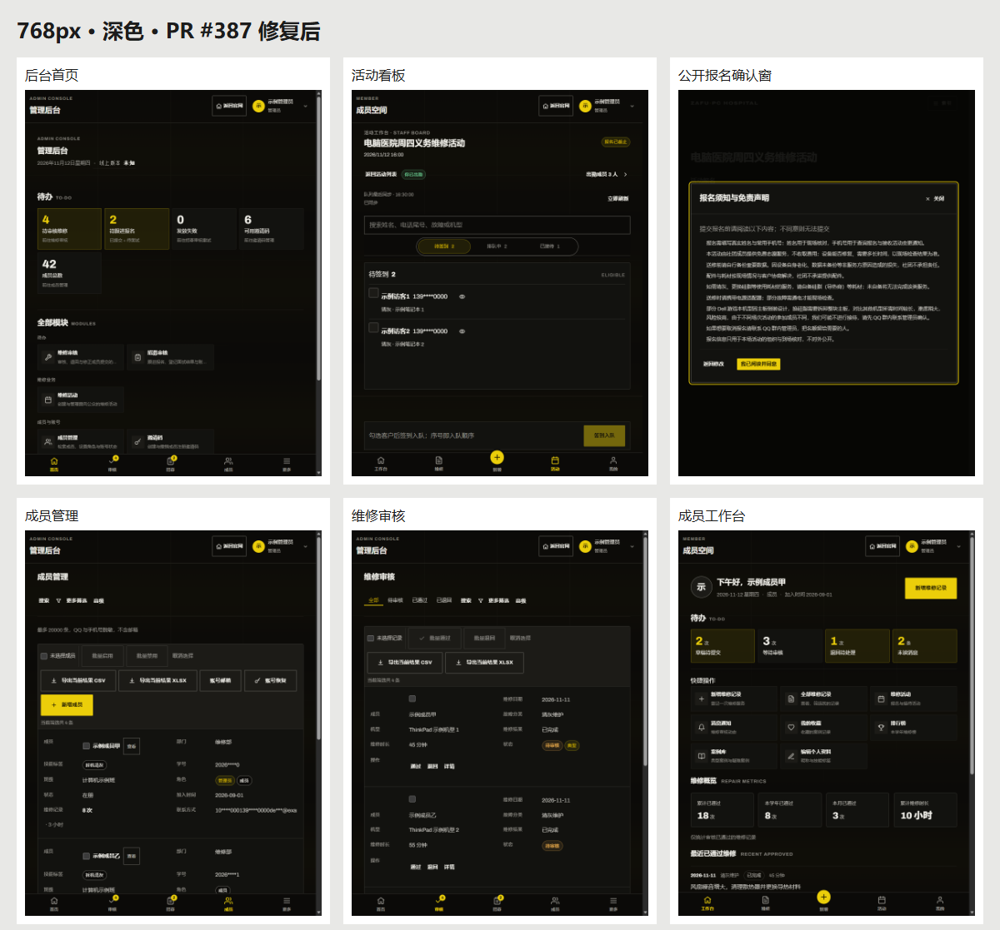
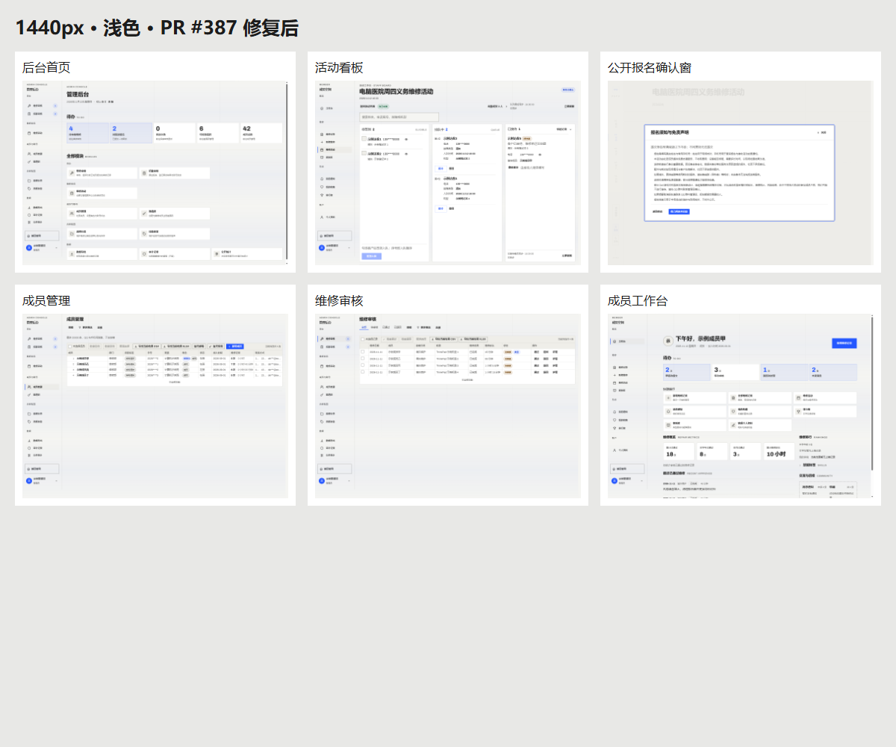
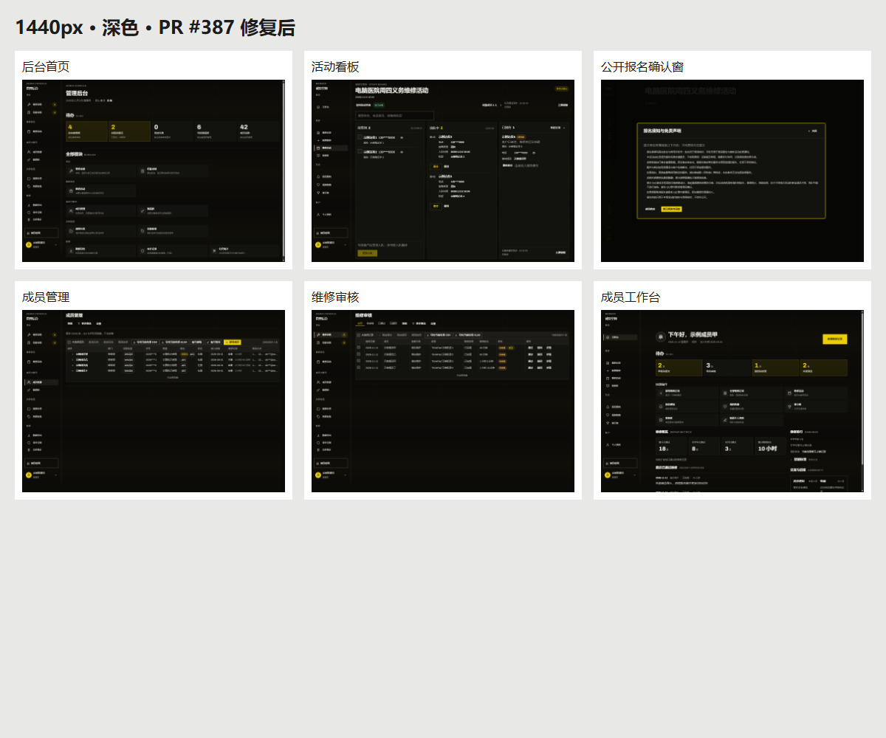
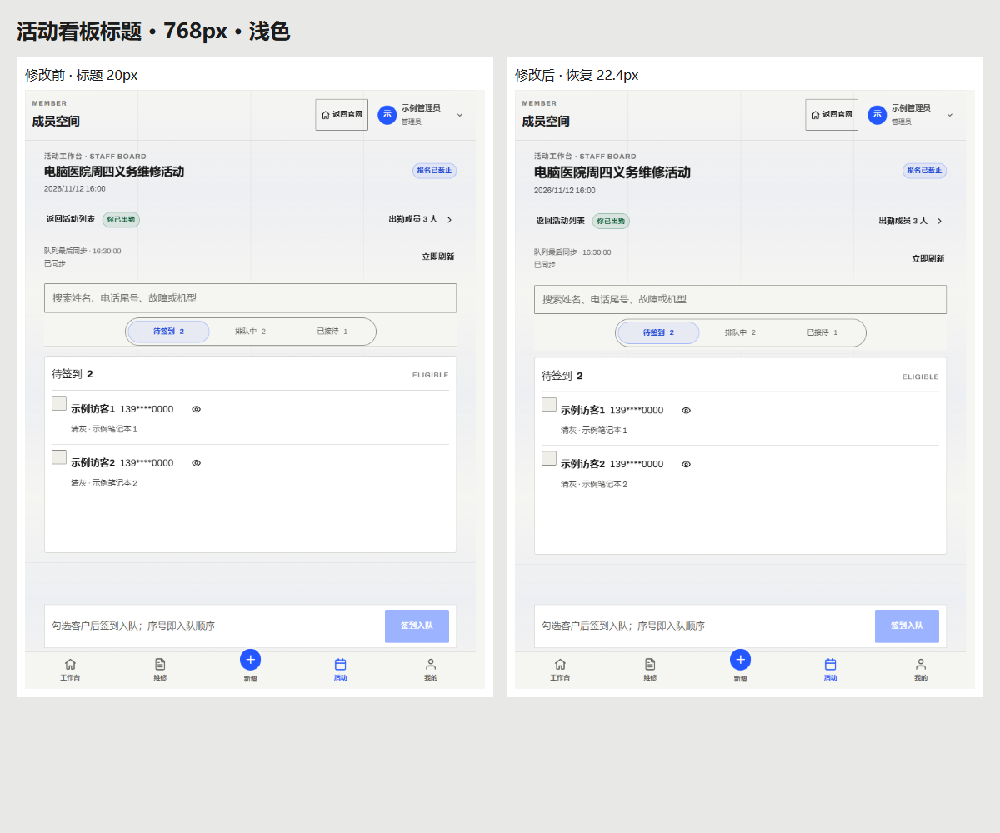
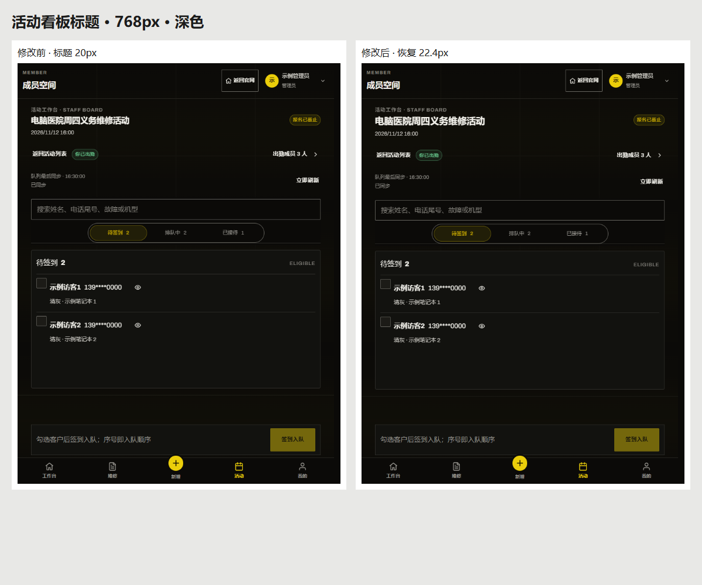
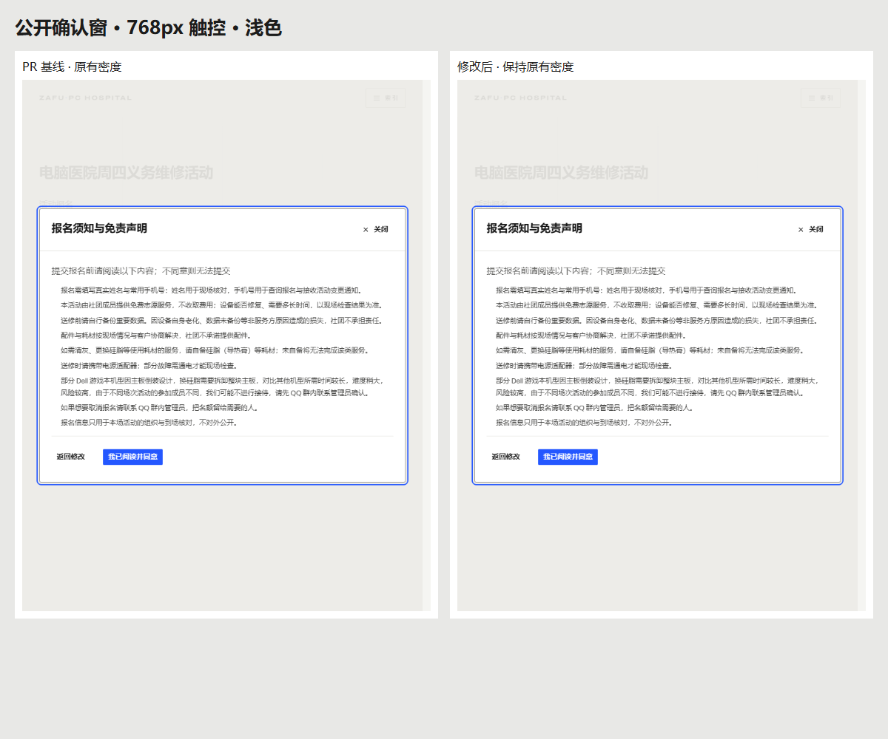
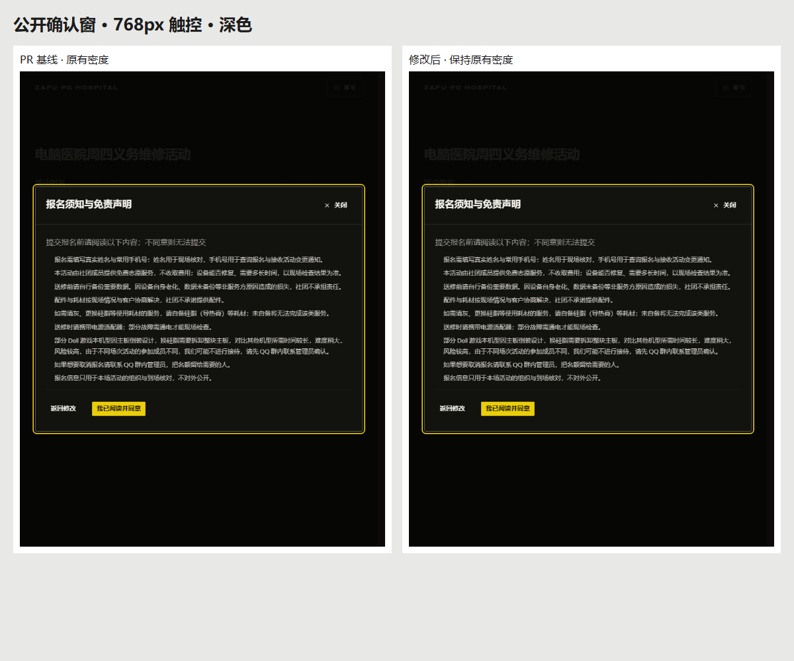

# PR #387 审查截图

对应 PR：https://github.com/ZAFU-PCHospital/zafu-pchospital-web/pull/387

代码提交：22649bbccce7188157a816d31d216a098d62f4c3

真实组件与对应版本 CSS，使用隔离示例数据。390 / 768px 使用 coarse 指针，1440px 使用 fine 指针；截图视口高度 1000px。

- [完整截图包（48 张原图、10 张汇总 / 对照图及验证记录）](screenshots/pr387-screenshots.zip)
- [DOM 验证记录](screenshots/verification.json)

## 三档尺寸

每张汇总依次展示后台首页、活动看板、公开报名确认窗、成员管理、维修审核、成员工作台；完整原图在截图包中。

### 390px

### 768px

### 1440px

## 活动看板标题

补改前标题 20px；补改后恢复 22.4px。桌面沿用原字号。

## 公开确认窗

PR 基线与补改后的按钮尺寸保持一致。

